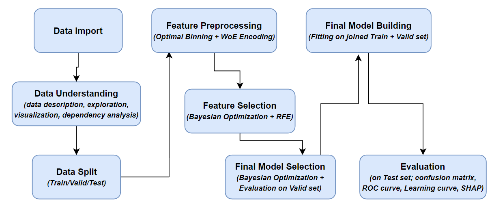
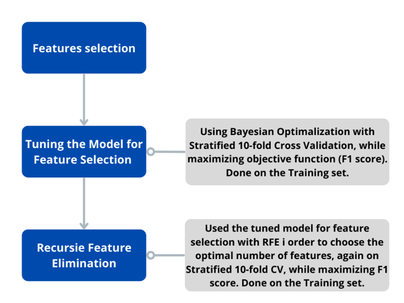
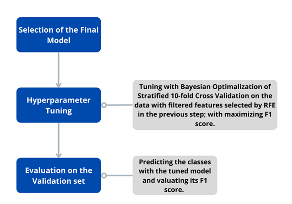

# Data-X Project 2022 - Mushroom classification

Repository for the project within the course **Data-X – Applied Data Analytics Models in Real World Tasks (4IT439)**, at Faculty of Informatics and Statistics, Prague University of Economics and Business (VŠE). Such project is conducted using Python.

_**Authors:**_ [**Petr Nguyen**](https://www.linkedin.com/in/petr-ngn/), [**Lukas Dolezal**](https://www.linkedin.com/in/lukas-dolezal75/), [**Roman Pavlata**](https://www.linkedin.com/in/roman-pavlata-a3b602161/), [**Patrik Korsch**](https://www.linkedin.com/in/patrik-korsch/), [**Daniel Bihany**](https://www.linkedin.com/in/daniel-bih%C3%A1ny-a2a095202/)

_**Deadline:**_ 24/10/2022

We have been provided with a mushroom dataset, based on which we have to create a model which will classify whether or not is particular mushroom edible.

Such tasks include data understanding and exploration, data preprocessing with feature engineering feature selection, building a model including hyperparameter tuning, with subsequent evaluation using F1 score.

## Repository structure and description
```
├── data     <- Data in raw form, transformed or data from third party sources.
│    │
│    ├── category_names_kaggle.txt    <- Category names for mapping values (extracted from Kaggle).
│    ├── interim.csv                  <- Data after Optimal Binning and WoE transformation.
│    ├── preprocessed.csv      	      <- Final preprocessed data after Binning, WoE transformation and feature selection.
│    ├── raw.csv                      <- The original, immutable data dump.
│
├── models   <- models and objects which have been fitted within our project (pickle files, despite the .h5 extension).
│    │
│    ├── binning_woe_model.h5         <- Optimal Binning and WoE transformation object (for feature preprocessing).
│    ├── feature_selection_model.h5   <- Optimized model used within feature selection (RFE).
│    ├── final_model.h5               <- The final optimized model trained on joined training and validation set.
│    ├── rfe_model.h5                 <- RFE object for feature selection.
│    ├── SHA256SUMS                   <- SHA-256 checksums of the model files (verify them before loading).
│
├── notebooks     <- All the Python scripts and Jupyter notebooks used in the project. 
│    │
│    ├── src_PN   <- Module containing auxiliary functions.
│    │     │
│    │     ├── __init__.py            <- __init__ for treating src_PN as a module.
│    │     ├── aux_functions.py       <- Auxiliary functions used solely in the notebook.
│    │
│    ├── final_notebook_aux_functions_imported.ipynb <- Final notebook to which the auxiliary functions are imported as module.
│    ├── final_notebook_aux_functions_included.ipynb <- Final notebook including the auxiliary functions in it.
│
├── README.md                         <- The top-level README for readers using this project.
├── Team04_Report.pdf                 <- Documentation of our project within the course submission.
├── *.png                             <- Flowcharts used in this README.
├── requirements.txt                  <- requirements file for reproducing the project.
```

### Installing the environment
First of all before running any scripts or notebooks, you should first install the environment. You should create a new environment using `Python 3.11`, which is the version the pinned dependencies in `requirements.txt` are tested with.

> The project was originally developed with Python 3.9.13 (in 2022). The dependencies have since been upgraded to fix known security vulnerabilities, and the patched versions (e.g. Pillow 13, tornado 6.6) require Python 3.11 or newer. Python 3.9 and 3.10 are no longer supported by the Python core team either.

You can create such environment in Anaconda, in the terminal as:
```bash
conda create -n yourenv python=3.11
```
Once you have created your own environment, you should then install all the packages with correct versions on which the notebooks and the module run. This is being done with the `requirements.txt` which you can find in this repository, particularly in the main branch. You should then download this file, open the Anaconda terminal, activate your environment as:

```bash
conda activate yourenv
```
And then install the environment:
```bash
pip install -r requirements.txt
```
Noted, if you do not change the directory in the terminal (using `cd` command), you should also add to it the path where the file is located.


### Importing the auxiliary functions
_The functions have been originally built with Python version 3.9.13 and are tested with Python 3.11_

Download the `src_PN` folder and the `final_notebook_aux_functions_imported.ipynb` notebook (they need to be stored in the same path/location). Or you can clone this whole repository using Git.

```
├── Your location
|       |
│       ├── src_PN
│       │      ├── __init__.py
│       │      ├── aux_functions.py 
│       │
|       ├── final_notebook_aux_functions_imported.ipynb
```

Afterwards, you will be able to import the auxiliary functions:

``` bash
import src_PN.aux_functions as aux
```
Otherwise, if you do not want to import the auxiliary functions as a module, you can download the notebook `final_notebook_aux_functions_included.ipynb`, in which the functions are defined directly.

### Loading a model
The fitted models in the `models` folder are [pickle](https://docs.python.org/3/library/pickle.html) files (despite the `.h5` extension).

> **Security warning:** unpickling a file can execute arbitrary code. Only load model files that you obtained from this repository, and verify their checksums first.

Verify the checksums (on Windows, use `CertUtil -hashfile <file> SHA256` and compare with `models/SHA256SUMS`):
```bash
cd models
shasum -a 256 -c SHA256SUMS
```
Then load the model with the auxiliary function, which can also verify the checksum right before unpickling:
```python
import src_PN.aux_functions as aux

model_loaded = aux.load_pickle('../models/final_model.h5',
                               expected_sha256 = '884d304c61e7b75ede04e645dc876b9c9850b0d08e38a168bf024ec479533035')
```
Or with the `pickle` package directly:
```python
import pickle

with open('final_model.h5', 'rb') as f:
    model_loaded = pickle.load(f)
```
The models require the scikit-learn version pinned in `requirements.txt`. The final model, the feature selection model and the RFE object were originally fitted with scikit-learn 1.0.2 and have been converted to the current scikit-learn version (the fitted trees were transferred as they are), so their predictions are identical to the original models.
## Machine Learning Flowchart
First, we import all the relevant data to the working space, with following data inspection and data understanding and exploration. Afterwards, the data split into training, validation and sets following with further data preprocessing in the form of binning and Weight-of-Evidence Encoding.

Once we have our data prepared, we perform an iterative process for feature selection using RFE in combination with hyperparameter tuning using Bayesian Optimization - the latter optimized the input model by tuning its hyperparameters and then this tuned model is used as an input within RFE. This results in $n$ different set of optimal features, assuming we have $n$ input models.

After the feature selection, we perform the selection of the final model. For each input model, we tune its hyperparameters with Bayesian Optimization on each set of optimal features selected within feature selection in the previous step. Once the model is optimized, then it is evaluated on the validation set. We choose such model, which has the highest metrics score and/or lowest cost functions. This results in $n^2$ tuned models, assuming we have $n$ input models.

Once we select the best, final model which performs the best on the validation set, we then build it by fitting it on the joined training and validation set. Finally, we evaluate the fitted model on the test set by calculating several metrics such as F1 score, Recall, Precision, Accuracy, AUC etc.



## Data Preprocessing
Following the data exploration, we deem reasonable to remove found duplicates (counting 6 rows) and 1 row containing erroneous category _EE_ in _stalk-shape_ feature. As mentioned, we also remapped the features' categories with their full names.

After the data split into training set, validation set and test set (approx. 74%; 11%; 15%); we have to convert the categorical features into numerical ones. For this case, we use `optbinning` package, which is available [here](https://github.com/guillermo-navas-palencia/optbinning). It uses optimal binning with respect to the target variable by rigorous and flexible mathematical programming formulation - in other words, it optimally groups the features' categories into bins. It can be either used for continuous features, where instead of grouping, the data will be optimally split into interval bins. We perform the Binning Process by fitting it on the training set with subsequent transforming of the training, validation and test set (based on the training set).

Once it bins the categories, we decide to transform these bins into numerical values by using Weight-of-Evidence Encoding which is commonly used in credit risk modelling and works better than dummy encoding when having larger amount of variables and categories/bins.


After such transformation, we then exclude such features which do have only one bin/category after binning. These features have zero-variance, thus they would not add any contribution in terms of predictions.

## Feature selection
Once we have our data prepared, we move to the next step which is the feature selection. We use an iterative process - each model with default hyperparameters is tuned using Bayesian Optimization with Stratified 10-fold Cross Validation. Afterwards, such tuned model is then used within Recursive Feature Elimination (RFE) with 10-fold Cross Validation which outputs a set of optimal features. Both tuning and feature selection is being conducted on the training set while maximizing an objective function of F1 score. Assuming $n$ models, we end up with $n$ sets of optimal features.



## Final Model Selection and Final Model Building.
The next step is the selection of the final model. Again we use an iterative process - each model with default hyperparameters is tuned on each set of features selected within RFE in the previous step, particularly on training set. This optimization is again being conducted on the training set while maximizing an objective function of F1 score. Then, each tuned model is then evaluated on the validation set. We select the final model based on the best scores evaluated on the validation set.

This final model is then built/fitted on the joined training and validation set which do have only the optimal features which are related to this final model (on which the final model has been fitted on the training set within the final model selection).




## Evaluation
Once the model is built, we then evaluate it on the hold out set - test set. We calculate such metrics which can be derived from the confusion matrix, such as Accuracy, Precision, Recall or F1 score. We also calculate other metrics which can be derived from the estimated probabilities, such as AUC, Gini coefficient, Kolmogorov-Smirnov test or Brier score loss.

Besides, we also construct a ROC curve and Learning curve to depict the model performance, as well as the plot of SHAP values to depict the contributions of features to a prediction.

